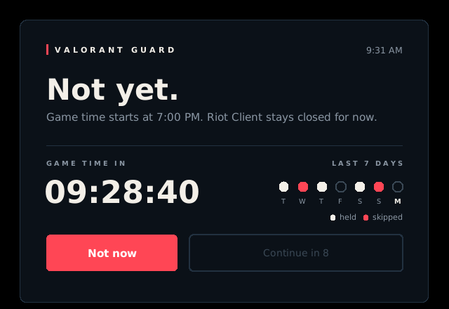

# Valorant Guard

A small Windows app that puts a speed bump between you and VALORANT before game time (7:00 PM by default).



## What it does

- **Warns before the Riot Client opens.** Your VALORANT shortcut runs Valorant Guard first. Before game time you get a full-screen warning with a live countdown, and the Riot Client only starts if you press **Continue anyway**.
- **Catches every other way in.** A background guard watches for the Riot Client or VALORANT starting any other way and shuts it down before its window loads, then shows the same warning.
- **Asks every time.** A Continue covers one sitting only. Close VALORANT or the Riot Client before game time and the next open asks again.
- **Makes you wait.** Continue unlocks after 15 seconds. Not now is the default (Enter or Esc).
- **Shows your week.** The warning shows the last 7 days: white for days you held off, red for days you skipped the warning.
- **Lives in the system tray.** Right-click the red V icon to preview the warning or quit. Quit keeps it off until your next Windows login.
- **Stays running.** It starts at login and a keepalive task restarts it within 5 minutes if it is ever closed (unless you quit it from the tray).

It never touches game memory. It only reads the process list and closes Riot processes the way Task Manager would. Riot Vanguard is never touched.

## Install

Requires Windows and Python 3 on PATH.

1. Download or clone this repo.
2. Run `install.bat`.
3. Delete or unpin Riot's original VALORANT shortcut and use the new one it creates.

To preview the warning without launching anything:

```
python valorant_guard.py --test
```

## Settings

Edit the top of `valorant_guard.py`, then run `install.bat` again:

| Setting | Default | Meaning |
| --- | --- | --- |
| `CUTOFF_HOUR`, `CUTOFF_MINUTE` | `19`, `0` | Game time (24 hour clock) |
| `CONTINUE_DELAY` | `15` | Seconds before Continue unlocks |
| `WATCH_PROCESSES` | Riot Client and VALORANT | Processes that trigger the warning |

## Uninstall

Run `uninstall.bat`. It removes the autostart entries, the keepalive task, the shortcuts and the app files.

## Files

| File | Purpose |
| --- | --- |
| `valorant_guard.py` | The app |
| `install.bat` | Builds `ValorantGuard.exe` and installs it |
| `uninstall.bat` | Removes everything |
